# Precinct findings, November 3, 2026

Preliminary Statement of the Vote, Report 11, published November 10, 2026 at 5:00 p.m. Phoenix (4:00 p.m. Pacific). Certification is due December 3. Every figure is stamped with that report. Totals below are San Francisco votes only.

The subject is where in the city each contest ran strong, and which precinct characteristics move with that pattern. The contests are the governor’s race inside the city, CA-11, and Measures B, G, I, and D. Each section has the citywide result, the precinct and supervisor-district geography, and the census comparison.

A share is the named side divided by the two-candidate vote, or by Yes plus No. Among precincts with at least 50 ballots, the 10th, 50th, and 90th percentiles are given as a range. District figures are vote-weighted. A correlation describes precincts with at least 50 ballots and with group quarters under 25 percent of the 2020 population. It describes the precinct. It does not say how the people in a demographic group voted.

The precinct map is DataSF’s 2022 shapes: 514 polygons, all 514 matched to the Statement of the Vote, reconciled to the citywide totals with a difference of zero. Districts come from the Department of Elections crosswalk of August 17, 2026. Four precincts have no registered voters and are left off the maps: Angel Island, Alameda Island, and two small inland precincts, 9901 in the Outer Mission and 9902 in Portola. Party registration is citywide only. The Department’s page, as of November 11, lists 543,430 registered voters (338,535 Democratic, 40,517 Republican, 141,829 no party preference or unknown), which is a different vintage from the 535,608 on the Statement of the Vote, so it is recorded and not mapped.

Turnout is 65.63 percent (351,502 of 535,608). Mail is 308,186 ballots, 87.68 percent, and election day is 43,316. Precinct 9723 in Lakeshore, which includes San Francisco State, reports 840 ballots against 772 registered voters. On Report 9 it reported 500 ballots; nearly all of the increase is election-day ballots, which went from 211 to 534. The Department has not explained it. A rate over 100 percent is not a turnout, so that precinct is left out of the turnout range and off the turnout map. Precinct turnout runs from 49.3 percent to 67.3 percent to 77.7 percent, higher in the north, the center, and the west, and lower in the southeast. It rises with the bachelor’s-degree share of the precinct (r = 0.81) and with the non-Hispanic white share (r = 0.80).

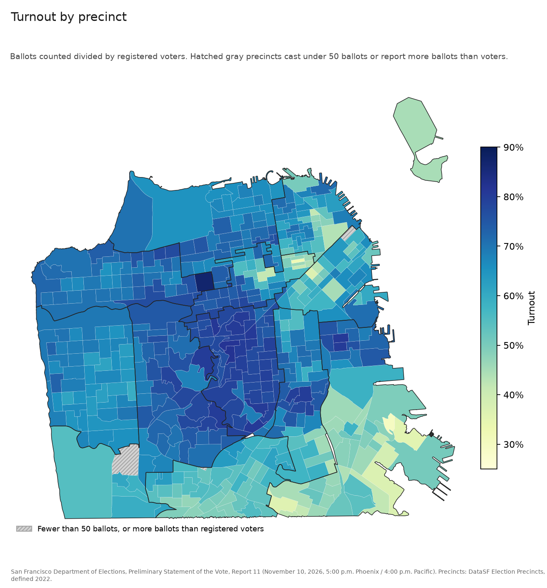

Census characteristics are 2020 block counts, or ACS 2020–2024 counts spread onto those blocks. All 873,965 people in the 2020 county count are assigned. A precinct line cuts 33 blocks, holding 0.3 percent of the population. On every other block, the Census internal point and the land-area majority name the same precinct. Citywide, bachelor’s degree or higher is 60 percent of adults 25 and older, renters are 62 percent of occupied units, foreign-born residents are 34 percent, and households at $150,000 or more are 48 percent.

## Governor, inside the city

Xavier Becerra 287,632, Steve Hilton 51,897. Hilton’s share of the two-candidate vote is 15.3 percent.

Precinct shares run from 7.0 percent to 15.4 percent to 25.4 percent. The higher shares are on the west side and in the south. Supervisor District 4 is 23.6 percent Hilton and District 11 is 20.7 percent. District 2 is 18.5 percent and District 7 is 17.1 percent. District 8 is 7.5 percent, District 9 is 9.8 percent, and District 5 is 10.0 percent. The spread from District 8 to District 4 is 16.1 points.

Hilton’s share rises with the non-Hispanic Asian share of the precinct (r = 0.69) and with the foreign-born share (r = 0.54). It is lower where the non-Hispanic white share is higher (r = −0.44) and where the renter share is higher (r = −0.39).

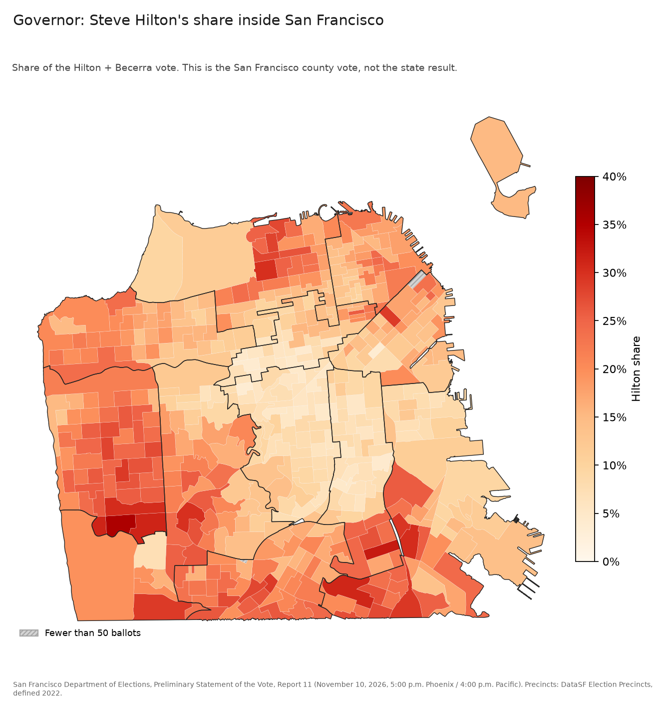

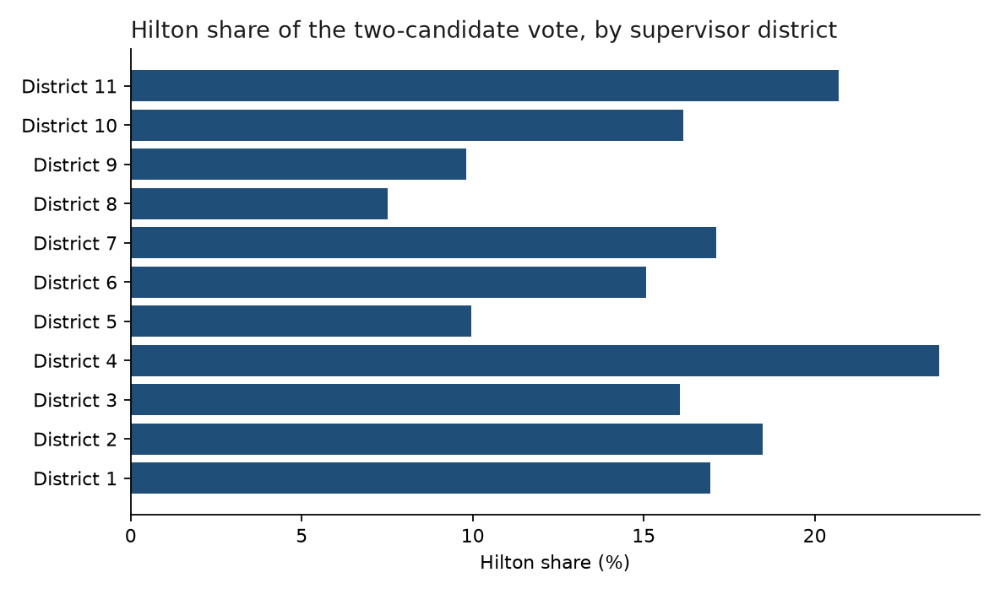

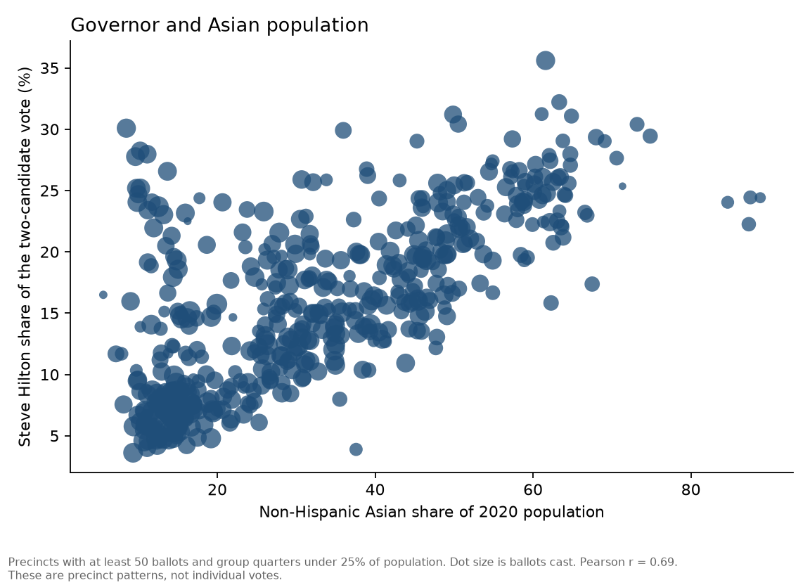

## CA-11

Scott Wiener 160,400 (53.3 percent), Connie Chan 140,395 (46.7 percent). Both are Democrats, so the map uses a purple-orange scale. The district is 453 of 514 precincts. The other 61 are in CA-15 and are hatched gray on the map. They form the city’s southern band. 56 of them are in the Excelsior, the Outer Mission, Oceanview–Merced–Ingleside, Portola, and Visitacion Valley, and the other five are around McLaren Park and in Bayview. The Lake Merced corner in the southwest is in CA-11.

Precinct shares inside the district, among those with at least 50 ballots, run from 35.4 percent to 47.2 percent to 59.3 percent. Chan leads in the Sunset, the Outer Richmond, the Mission, Bayview, and Chinatown. Wiener leads in the Inner Richmond, the Castro, Noe Valley, and most of the north side, from the Marina to Pacific Heights. Counting CA-11 precincts only, Chan’s share is 59.0 percent in supervisor District 4, 53.4 percent in District 9, and 51.2 percent in District 1. It is 37.4 percent in District 8 and 37.6 percent in District 2. Supervisor District 11 contributes only 1,784 votes to this race, because most of that supervisor district sits in CA-15. Those votes are 58.6 percent Chan.

Chan’s share is lower where the non-Hispanic white share is higher (r = −0.71) and where the bachelor’s-degree share is higher (r = −0.64). It rises with the non-Hispanic Asian share (r = 0.55) and with the foreign-born share (r = 0.48). Those four move together across the west side of the district.

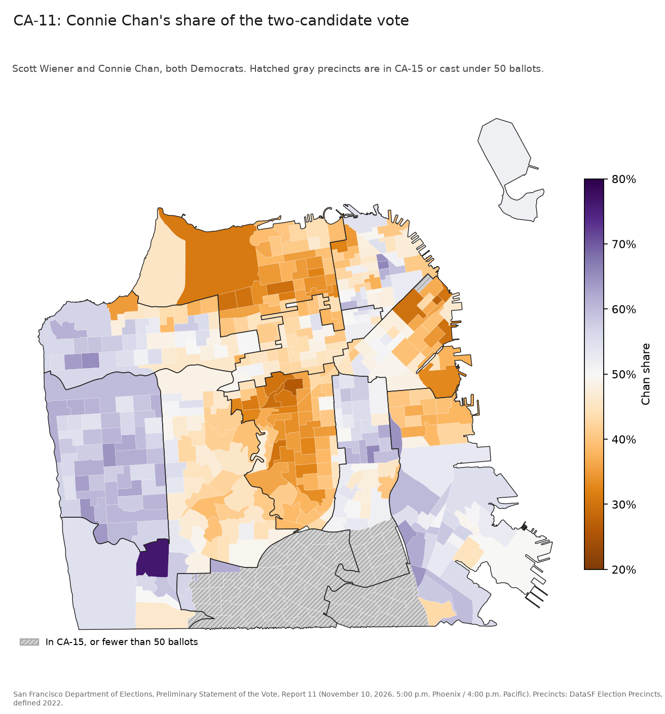

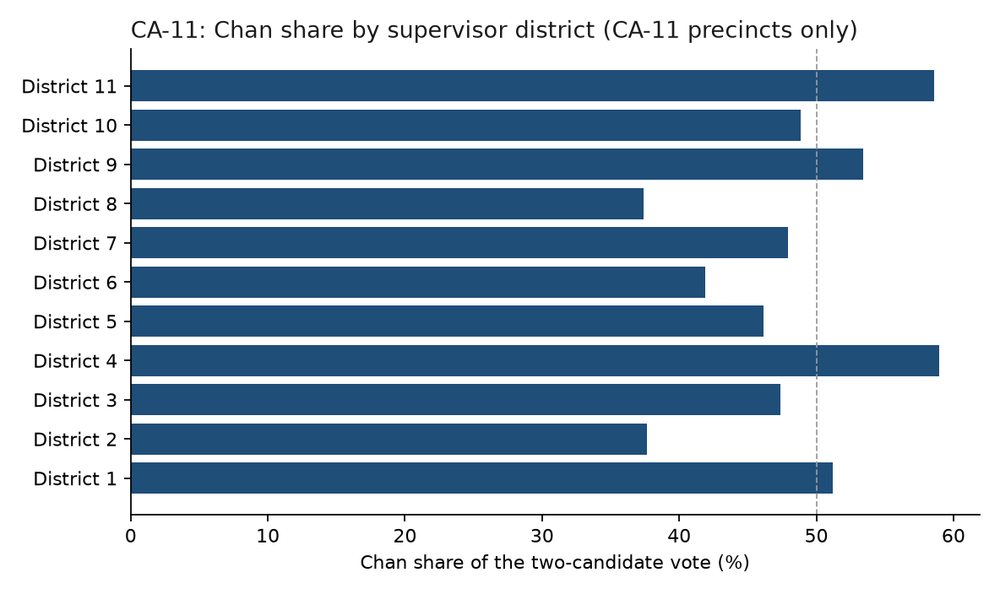

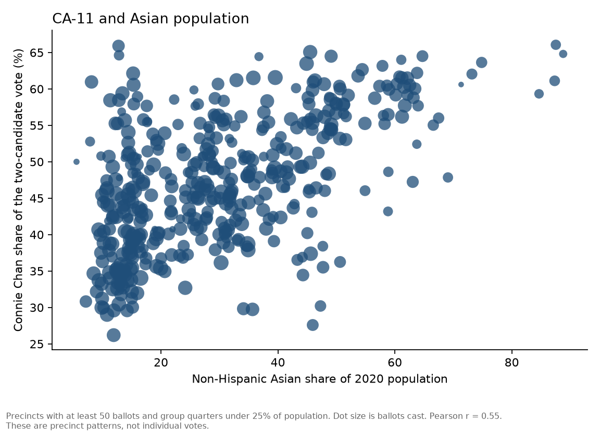

## Measure B

Establishing a Municipal Finance Corporation and a Public Bank. Yes 169,415, No 152,252. The yes share is 52.7 percent. On the November 4 report, No still led, by 144 votes, at 49.96 percent yes.

Precinct shares run from 39.3 percent to 53.4 percent to 65.5 percent. The yes vote is stronger in the center and the east, and weaker on the west side and in District 2 in the north. District 9 is 64.3 percent yes and District 5 is 62.3 percent. District 10 is 55.8 percent and District 8 is 54.2 percent. District 2 is 41.3 percent, District 4 is 46.1 percent, and District 7 is 46.2 percent. The spread from District 2 to District 9 is 23.0 points.

The yes share rises with the Hispanic share of the precinct (r = 0.55) and with the renter share (r = 0.43). It is lower where the share of households at $150,000 or more is higher (r = −0.45). The foreign-born share barely moves with it (r = 0.08).

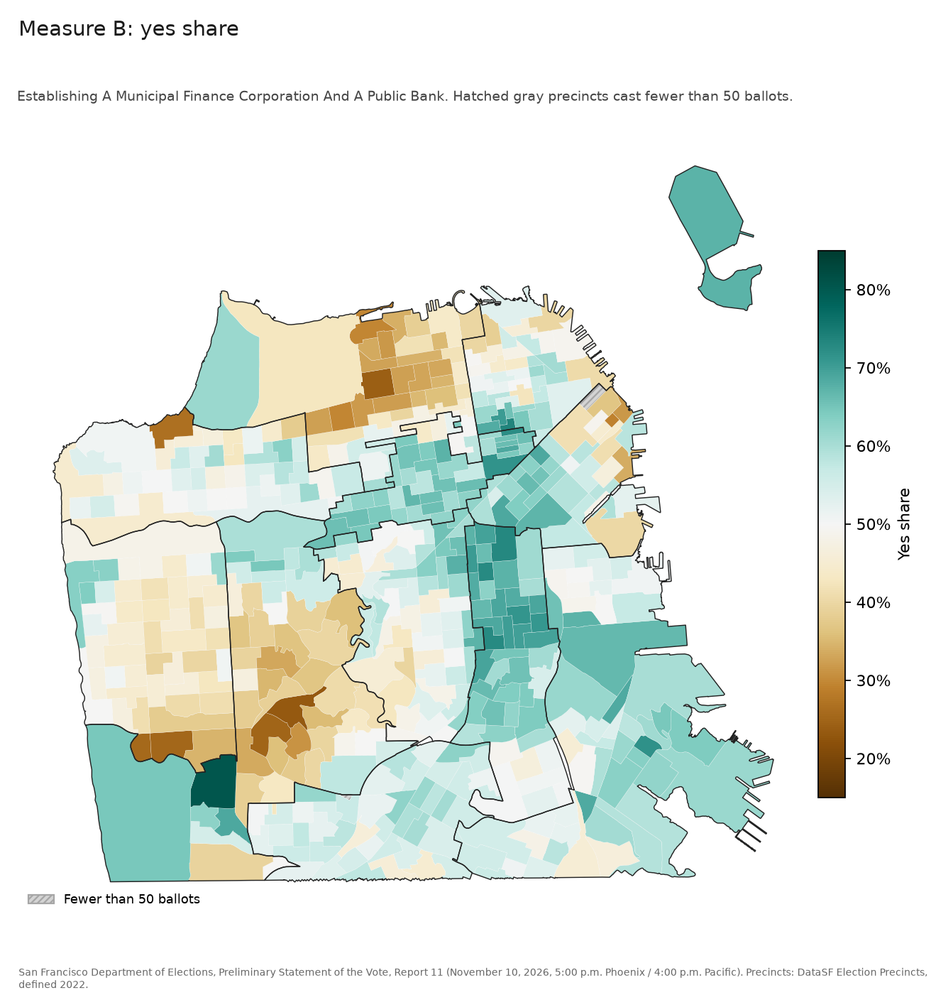

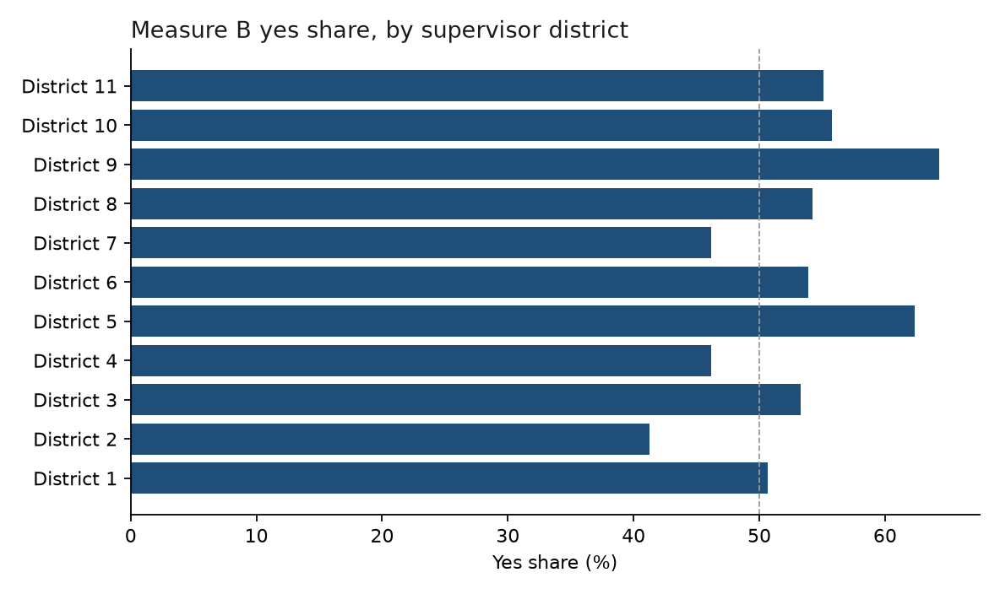

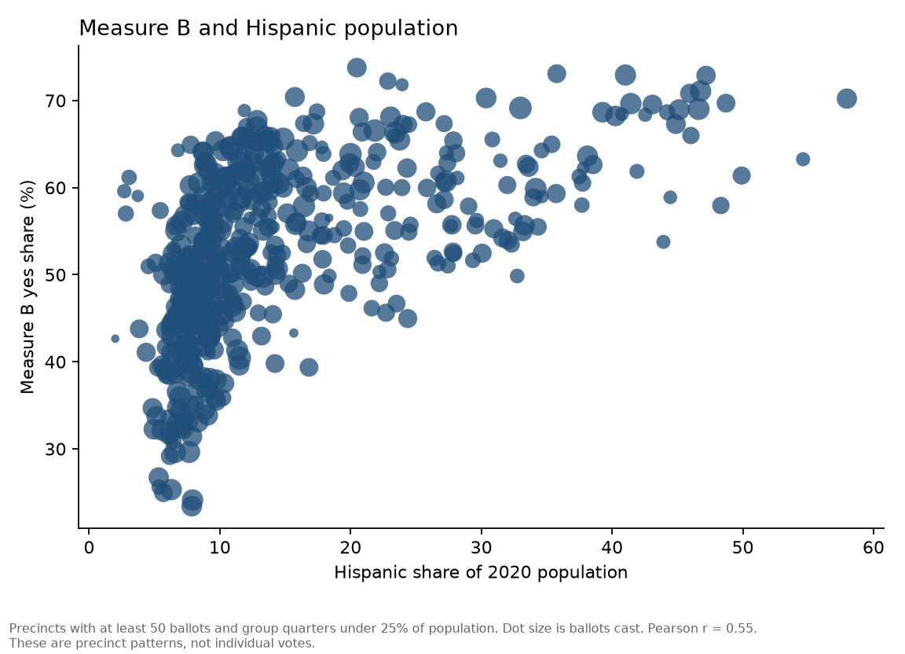

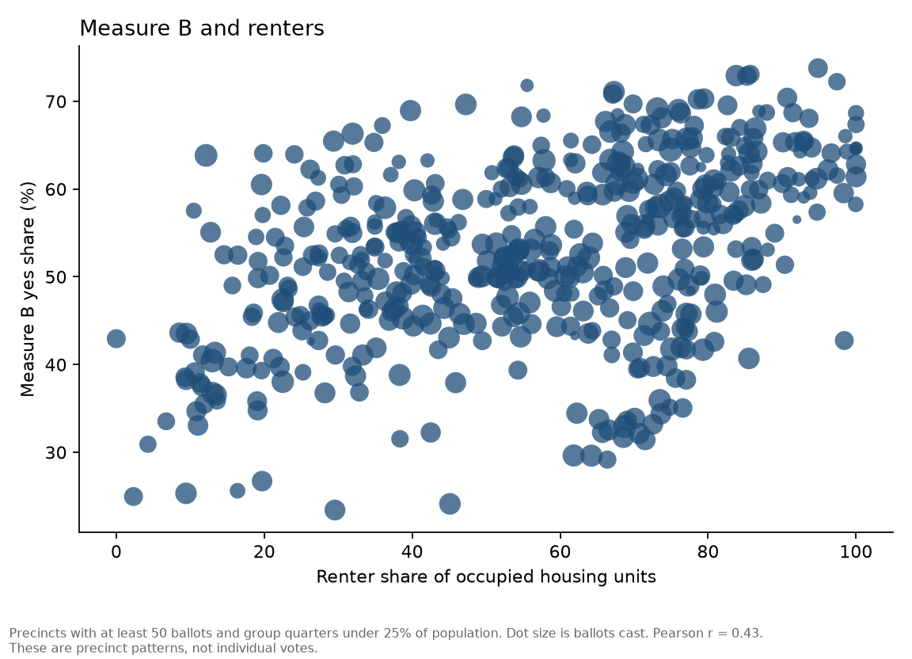

## Measure G

Allowing private vehicles on the Great Highway in Sunset Dunes Park. Yes 112,765, No 215,803. The yes share is 34.3 percent.

Precinct shares run from 18.9 percent to 33.8 percent to 51.5 percent, the widest range of these six contests. The ocean side voted yes at a much higher rate than the center of the city. This is the sharp east-west split among the local measures (correlation of the precinct yes share with easting, −0.51), and the yes share is also higher toward the south (correlation with latitude, −0.37). District 1 is 49.6 percent yes and District 4 is 49.4 percent. District 11 is 45.0 percent and District 7 is 39.9 percent. District 8 is 21.3 percent, District 5 is 22.6 percent, and District 6 is 25.2 percent. The spread from District 8 to District 1 is 28.3 points.

The yes share rises with the non-Hispanic Asian share of the precinct (r = 0.67) and with the foreign-born share (r = 0.46). It is lower where the renter share is higher (r = −0.52) and where the non-Hispanic white share is higher (r = −0.52).

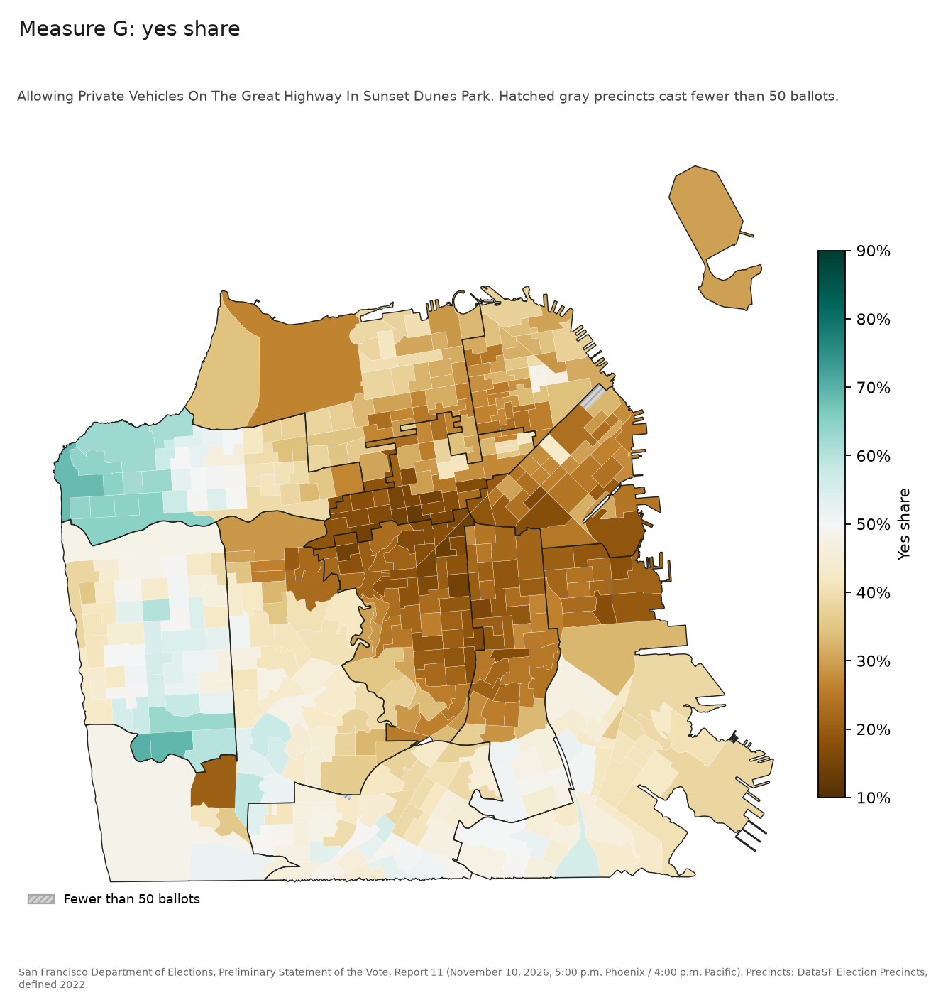

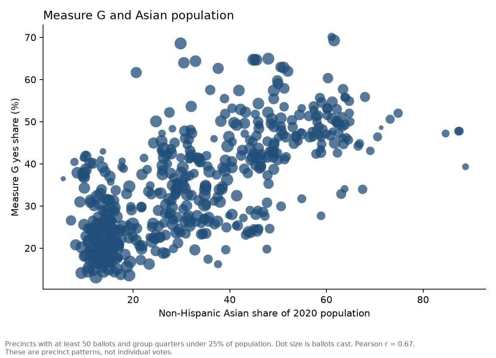

## Measure I

Changes to the real property transfer tax. Yes 155,384, No 166,070. The yes share is 48.3 percent. No leads by 10,686 votes.

Precinct shares run from 35.1 percent to 49.3 percent to 61.2 percent. The yes vote is stronger in the center and the east, in the same parts of the city as Measure B, a few points lower. District 9 is 59.2 percent yes and District 5 is 57.9 percent. District 6 and District 10 are both 51.0 percent. District 2 is 37.4 percent, District 7 is 41.4 percent, and District 4 is 43.7 percent. The spread from District 2 to District 9 is 21.8 points.

The yes share rises with the Hispanic share of the precinct (r = 0.50) and with the renter share (r = 0.47). It is lower where the share of households at $150,000 or more is higher (r = −0.49). The same three characteristics move with Measure B.

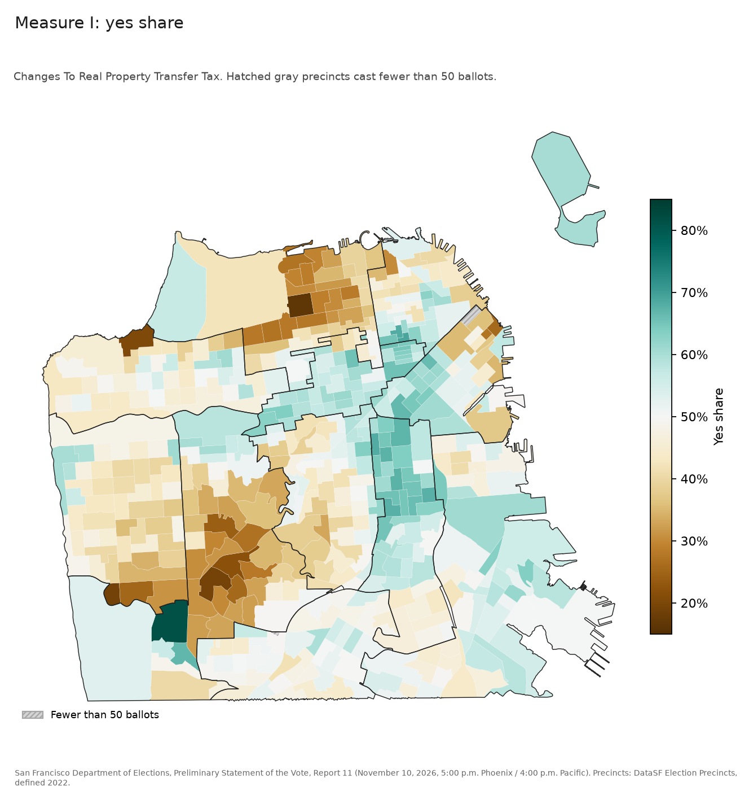

## Measure D

Changes to the ballot measure process. Yes 178,653, No 151,011. The yes share is 54.2 percent.

Precinct shares run from 43.5 percent to 51.5 percent to 67.1 percent. The split runs north to south. The correlation with easting is 0.02, and the correlation with latitude is 0.38. The north voted yes heavily. District 2 is 67.5 percent yes. Districts 6, 8, and 7 are 58.5, 58.3, and 57.4 percent. Four districts are under half: District 9 (the Mission, Bernal Heights, and Portola) is 44.4 percent, District 11 (the Excelsior, the Outer Mission, and Oceanview) is 47.8 percent, District 4 (the Sunset) is 48.8 percent, and District 5 (the Western Addition, Hayes Valley, the Haight, and the Tenderloin) is 49.3 percent. The spread from District 9 to District 2 is 23.1 points.

The yes share rises with the non-Hispanic white share of the precinct (r = 0.59) and with the bachelor’s-degree share (r = 0.56). It is lower where the Hispanic share is higher (r = −0.53). Households at $150,000 or more move with the yes share as well (r = 0.47).

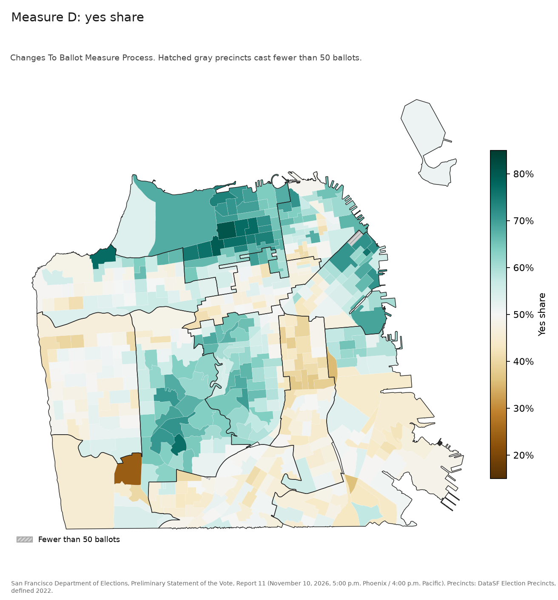

## Where the other local measures sit

The screen is `output/measure_screening.csv`. A measure besides the four above was left unmapped when the citywide yes share was more than 5 points from 50 and the east-west correlation was under 0.5. Supervisor-district spreads of 18.0 to 28.3 points are ordinary here, so spread alone did not earn a map.

| Measure | Yes share | East-west r | In one line |
| --- | ---: | ---: | --- |
| A, charter changes to departments and commissions | 68.0% | −0.06 | Passing, little east-west tilt |
| C, contributions to the housing fund | 81.8% | 0.46 | Passing in a landslide, some eastward lean |
| E, city administrator and contracting | 63.8% | −0.03 | Passing, little east-west tilt |
| F, executive branch management | 59.5% | −0.05 | Passing, little east-west tilt |
| H, parcel tax for Muni | 74.4% | 0.37 | Passing, some eastward lean |
| J, foreclosure exemption on the transfer tax | 80.9% | 0.34 | Passing in a landslide, some eastward lean |
| RTM, regional transit measure | 79.2% | 0.42 | Passing in a landslide, some eastward lean |
